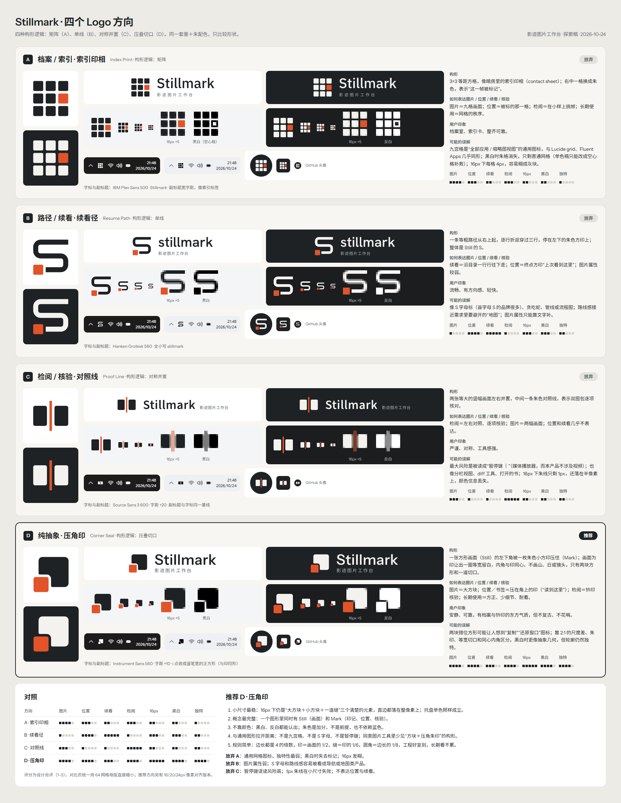
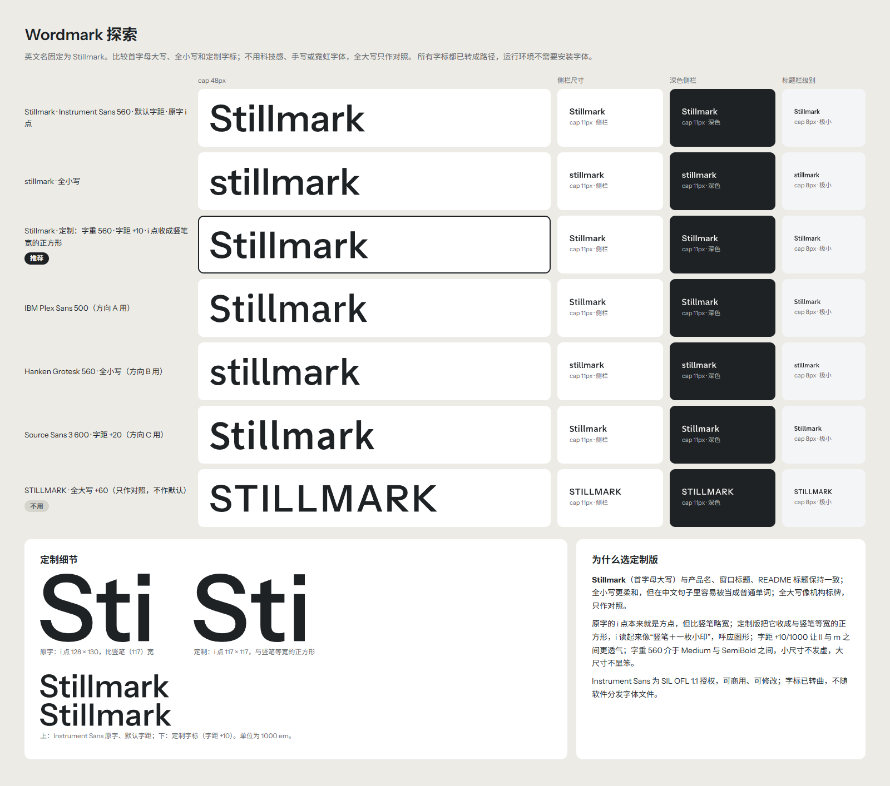
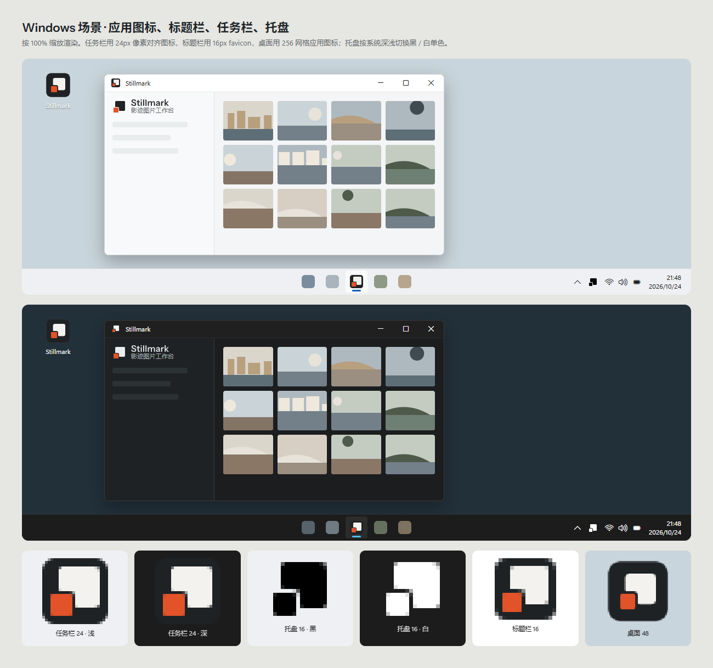
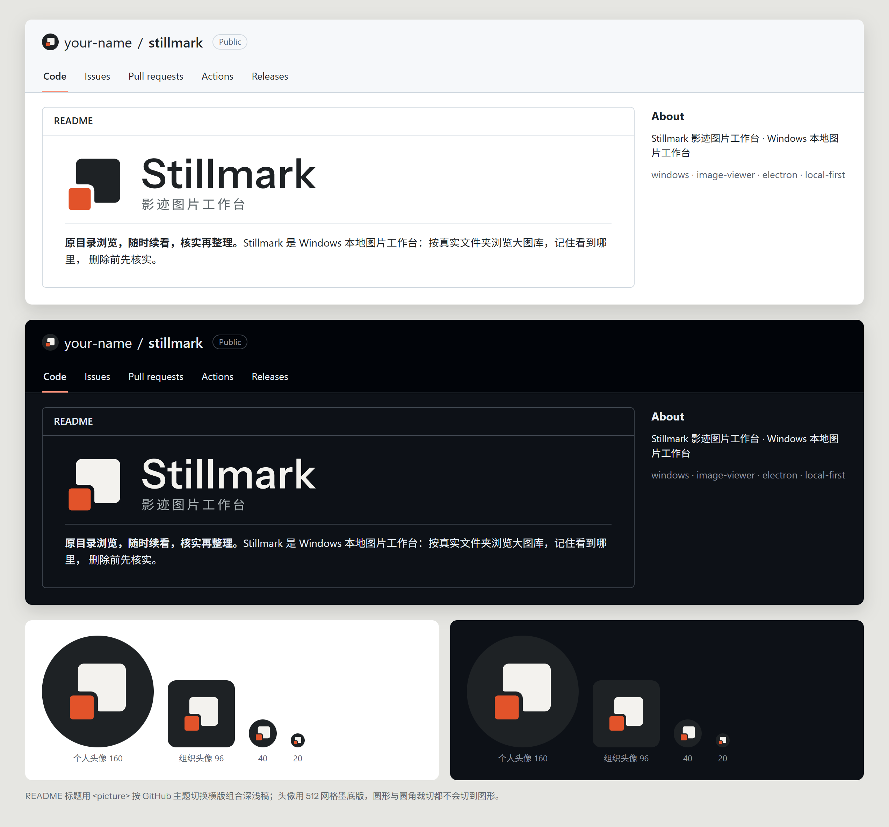
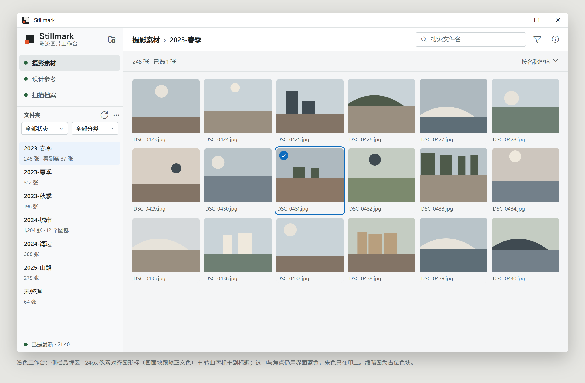
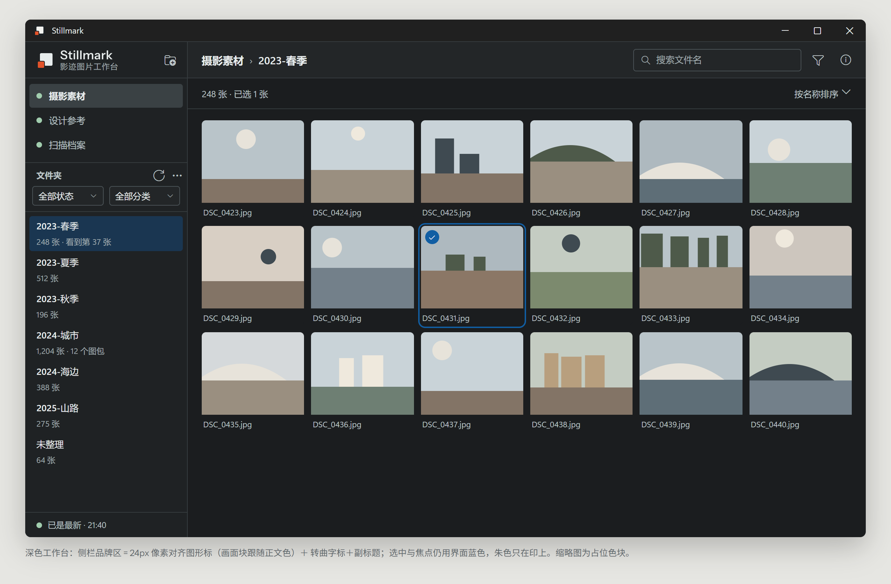

# Stillmark 品牌标识与 SVG 资产

> Stillmark 影迹图片工作台 · 品牌提案 v1.0 · 2026-10-24
> 设计交付阶段只制作品牌和矢量资产。2026-10-24 用户已确认 D「压角印」，工程侧按规范接入正式界面和桌面；以下四方案比较保留为设计依据，工程验收另附记录。

## 1. 四个 Logo 方向对比

每个方向在对比页中都包含以下内容：

- 图形、字标、中文副标题的排法
- 16 / 24 / 32 / 64px 缩小测试
- 浅色和深色背景
- Windows 托盘（深浅任务栏）
- GitHub 头像（圆形、圆角）

字标探索比较了 `Stillmark`、`stillmark` 和定制字标：

## 2. 各方向设计说明

| 方向 | 构形逻辑 | 怎样表达图片 / 位置 / 续看 / 核验 | 用户印象 | 可能的误解 |
|---|---|---|---|---|
| **A 档案 / 索引 · 索引印相** | 矩阵：3×3 等距方格，右中一格换成朱色，像索引印相上被标出的一帧 | 图片、检阅较强；位置一般 | 档案室、索引卡、整齐 | 九宫格是“全部应用 / 缩略图视图”的通用图标；黑白时标记消失；16px 每格只有 4px，容易糊 |
| **B 路径 / 续看 · 续看径** | 单线：等粗路径逐行折返，停在左下朱印上，整体是 S | 位置、续看最强；图片感弱 | 流畅、有方向感 | S 字母标、贪吃蛇、管线；路线感接近需求里要避开的“地图” |
| **C 检阅 / 核验 · 对照线** | 对称并置：两幅竖画面，中间一条朱色对照线 | 检阅、核验最强；不表达位置和续看 | 严谨、对称、工具感 | 容易被看成“暂停键 ‖”；也像分栏视图、diff；16px 下朱线只有 1px 宽，还落在半像素上，会发虚变淡 |
| **D 纯抽象 · 压角印** | 压叠切口：方形画面的左下角压一枚朱印，画面让出等宽切缝，内角与印同心 | 图片（画面）、位置 / 书签（印）、核验（钤印）、长期使用（方正少细节） | 安静、可靠，有档案与钤印的东方气质 | 可能联想到“复制”“还原窗口”图标；靠 2:1 尺度差、朱印、等宽切缝和同心内角区分 |

各方向配的字标：

| 方向 | 字体 | 副标题排法 |
|---|---|---|
| A | IBM Plex Sans 500 | 宽字距，像索引标签 |
| B | Hanken Grotesk 560，全小写 | 在字标下方 |
| C | Source Sans 3 600，字距 +20 | 与字标同一基线 |
| D | Instrument Sans 560 定制 | 在字标下方，与图形上下对齐 |

## 3. 推荐方向与放弃理由

**推荐 D · 压角印。**

1. **小尺寸最稳**。16px 下仍是“大方块＋小方块＋一道缝”三个清楚的元素，直边都落在整像素上；托盘单色照样成立。
2. **概念最完整**。一个图形里同时有 Still（画面）和 Mark（印记、位置、核验）。
3. **不靠颜色**。黑白、反白都能认出来；朱色是加分项，不是前提，也不依赖蓝色。
4. **和通用图形拉开距离**。它不是九宫格、不是 S 字母、也不是暂停键。
5. **规则简单**。边长都是 4 的倍数；印是画面的 1/2，缝是印的 1/6，圆角是边长的 1/8。工程好复刻，长期看不累。

放弃其他方向的原因：

- **A**：本质是通用网格图标，独特性最弱；黑白时失去标记；16px 发糊。
- **B**：图片属性弱；S 字母和路线感容易被看成导航或地图类产品。
- **C**：被看成暂停键的风险高；1px 朱线在小尺寸失效；不表达位置和续看。

## 4. 推荐方向的各个版本

| 版本 | 文件 |
|---|---|
| 彩色（自动深浅） | [stillmark-mark.svg](stillmark-mark.svg) |
| 浅色背景 | [stillmark-mark-light.svg](stillmark-mark-light.svg) |
| 深色背景 | [stillmark-mark-dark.svg](stillmark-mark-dark.svg) |
| 单色（currentColor） | [stillmark-mark-monochrome.svg](stillmark-mark-monochrome.svg) |
| 纯黑 / 纯白 | [extra/stillmark-mark-black.svg](extra/stillmark-mark-black.svg) / [extra/stillmark-mark-white.svg](extra/stillmark-mark-white.svg) |
| 单色反白（镂空） | [extra/stillmark-mark-reverse.svg](extra/stillmark-mark-reverse.svg) |
| 小尺寸（像素对齐） | [extra/stillmark-mark-16.svg](extra/stillmark-mark-16.svg)、[extra/stillmark-mark-24.svg](extra/stillmark-mark-24.svg)、托盘 16 / 20 / 24、favicon 16、应用图标 24 |

## 5. SVG 源文件

主交付：

| 文件 | viewBox |
|---|---|
| `stillmark-mark.svg` | 64 × 64 |
| `stillmark-mark-monochrome.svg` | 64 × 64 |
| `stillmark-mark-light.svg` | 64 × 64 |
| `stillmark-mark-dark.svg` | 64 × 64 |
| `stillmark-wordmark.svg` | 420 × 96 |
| `stillmark-lockup.svg` | 560 × 128 |
| `stillmark-favicon.svg` | 16 × 16 |
| `stillmark-tray.svg` | 16 × 16 |
| `stillmark-app-icon.svg` | 256 × 256 |

另有 `extra/` 下的补充文件，完整用途见[品牌规范第 2 节](stillmark-brand-guidelines.md#2-文件)。

技术情况：

- 全部是纯路径（`path` + `fill`）：没有位图、滤镜、渐变、外部字体或外部 CSS，也没有编辑器元数据。
- 字标和副标题已转曲。
- 每个文件 0.4–10.5 KB。
- 已用 XML 解析检查过全部文件，并用 Edge（Electron 同内核）渲染了所有尺寸。
- 设计交付时没有实际跑过 .ico 转换。工程接入后已用 Edge＋Pillow 完成七档 ICO 和四档黑白托盘位图、Windows 原生图标提取与实际 Electron 验证，见 [品牌集成记录](../../brand-integration-20261024.md)。自动深浅版在转换工具忽略内部样式时仍会回退为浅色稿；实际工程使用明确版本。

生成脚本在 [source/](source/README.md)，可重复生成：

- `build_assets.py`：生成全部 SVG
- `pages.py`：生成预览页
- `render.cjs`：把预览页渲染成 PNG

## 6. PNG 预览图

| 文件 | 内容 |
|---|---|
| [stillmark-brand-sheet.png](stillmark-brand-sheet.png) | 品牌速览：组合、各版本、图标、小尺寸、颜色、字体、构造、留白、错误用法、界面共存 |
| [exploration/stillmark-directions.png](exploration/stillmark-directions.png) | 四个方向对比 |
| [exploration/stillmark-wordmarks.png](exploration/stillmark-wordmarks.png) | 字标探索 |
| [previews/stillmark-windows.png](previews/stillmark-windows.png) | Windows 应用图标、标题栏、任务栏、托盘（100% 缩放） |
| [previews/stillmark-workbench-light.png](previews/stillmark-workbench-light.png) / [stillmark-workbench-dark.png](previews/stillmark-workbench-dark.png) | 浅色、深色工作台和侧栏品牌区 |
| [previews/stillmark-splash.png](previews/stillmark-splash.png) | 启动页 |
| [previews/stillmark-viewer.png](previews/stillmark-viewer.png) | 图片查看器顶部 |
| [previews/stillmark-github.png](previews/stillmark-github.png) | GitHub 仓库头像和 README 标题 |
| [previews/stillmark-small-sizes.png](previews/stillmark-small-sizes.png) | 16 / 20 / 24 / 32px 实际像素与放大 |

预览里的缩略图都是占位色块，没有使用任何真实图库内容。

## 7. 应用图标、托盘和 GitHub 头像

## 8. 品牌使用规范

完整内容见 [stillmark-brand-guidelines.md](stillmark-brand-guidelines.md)，包括：

- 颜色与对比度
- 构造比例
- 留白和最小尺寸
- 版本选用
- 小尺寸规则
- 字体与授权
- 错误用法
- 工程接入清单

## 9. 与现有界面配色共存

- **朱色只用在标志里**，不做按钮、链接、选中、进度或提醒。界面的删除色 `#b33835` 与朱色同属红橙色系，混用会让“删除”和“品牌”难以区分。
- **选择、焦点、链接继续用蓝色 accent**；标志不需要蓝色。
- **侧栏**：画面块跟随正文色（`--text`），印保持朱色。现在给图标套 `--accent-text` 的写法要去掉。
- **查看器**：顶部只放纯白单色标（不透明度 70–80%），见[查看器预览](previews/stillmark-viewer.png)。
- **启动页**：用纸色或墨色底，进度条用石色，见[启动页预览](previews/stillmark-splash.png)。
- **界面图标**继续用 Lucide，不改成朱色。
- 品牌没有引入新的界面字体，界面仍用 Segoe UI Variable / Microsoft YaHei UI。

## 10. 商标、GitHub 仓库名与同名产品

以下结果来自 2026-10-24 的网页搜索和 GitHub API 查询，**不是正式的商标检索**。

| 名称 / 项目 | 是什么 | 风险 |
|---|---|---|
| [Stillmark（stillmark.com）](https://www.stillmark.com/) | 专注比特币的风险投资机构，2019 年成立（[Maddyness 报道](https://www.maddyness.com/uk/2021/11/01/the-first-bitcoin-focused-venture-capital-firm-a-profile-of-stillmark/)、[Crunchbase](https://www.crunchbase.com/organization/stillmark)） | 中。行业不同，但英文搜索“Stillmark”基本被它占据，而且容易带出“区块链”联想，这正是需求要避开的方向 |
| [IftatBhuiyan/Stillmark](https://github.com/IftatBhuiyan/Stillmark) | Windows 截图与录屏工具（GPL-3.0，Eclipse Studios，2026-10-15 创建），有 macOS 预览版；使用 `.stillmark` 工程文件，Mac 版把截图存到 `~/Pictures/Stillmark` | **高**。同平台，同属“图片”相邻品类，是最直接的冲突 |
| [wming9728-gif/Still-mark](https://github.com/wming9728-gif/Still-mark) | Windows 离线 Markdown 阅读 / 编辑器（MIT）；winget 已有 `Leinner.Stillmark` 1.0.0 的提交（[PR #453072](https://github.com/microsoft/winget-pkgs/pull/453072)） | 中。同平台，`winget search stillmark` 会出现它 |
| [callmeteus/stillmark](https://github.com/callmeteus/stillmark) | 给 AI 代理用的路线图 / 计划 CLI，已发布 npm 包 `stillmark`，官网 [stillmark.dev](http://stillmark.dev/) | 低到中。npm 包名和 .dev 域名已被占用 |
| [yunforge/obsidian-theme-stillmark](https://github.com/yunforge/obsidian-theme-stillmark) | Obsidian 主题，移植自同名思源笔记主题 | 低 |
| [pooriamn/StillMark](https://github.com/pooriamn/StillMark) | 个人作品集网站 | 低 |
| [Stilmark](https://www.linkedin.com/company/stilmark)（单 l） | 丹麦营销自动化软件公司，1998 年成立 | 低。拼写相近 |
| 中文名“影迹” | [FilmTrack（影迹）](https://blog.csdn.net/weixin_44203560/article/details/148822029)，个人影视记录工具；[相迹 PhotoTrail](https://rookiefish.com/)，照片整理助手 | 低到中。“相迹”与本产品读音和品类都接近 |
| 商标 | 网页搜索“Stillmark trademark”没有看到“STILLMARK”的 USPTO、Trademarkia 或 Justia 记录，结果主要是上面那家 VC 的资料（如 [superscout 介绍页](https://superscout.co/investor/stillmark)） | 未知，需要正式检索 |

建议：

1. **对外始终带描述词**：写成“Stillmark 影迹图片工作台”或“Stillmark Image Workbench”，不要只写 Stillmark。图形标比英文名更容易形成独占识别。
2. **GitHub 仓库**：仓库名按账号区分，`<账号>/stillmark` 可以用。为便于搜索区分，可以考虑 `stillmark-workbench`，并在简介里写全称，topics 加上 windows、image-viewer。
3. **各类标识符都加前缀**：
   - npm 名 `stillmark` 已被占用，需要发包时用 `@<scope>/stillmark`。
   - winget ID 用 `<发布者>.StillmarkWorkbench` 之类，避免与 `Leinner.Stillmark` 混淆。
   - Windows 的 AppUserModelID 同样带发布者前缀。
4. **避开截图工具已经在用的命名**：不用 `.stillmark` 扩展名，不用 `Pictures\Stillmark` 之类的目录。数据目录继续沿用现有的 `GALLERY_DATA` 规则，不因改名而迁移。
5. **公开发布前做正式检索**：中国商标网（CNIPA）第 9 类（软件）和第 42 类（软件设计 / 软件服务），以及 USPTO、EUIPO、WIPO Global Brand Database。如需注册，可以考虑图形标与文字分开申请。
6. **域名**：stillmark.com 和 stillmark.dev 已被占用，其他后缀需要另行查询。

## 验收自查

| 验收项 | 结果 |
|---|---|
| 去掉文字后，图形仍有辨识度 | 通过。图形单独成立，见对比页 D 行 |
| 16px 下不会糊成方框或圆点 | 通过。像素对齐版的直边都在整像素上，见小尺寸检查 |
| 黑白打印能识别 | 通过。有纯黑稿、反白稿和单色稿 |
| 深浅主题都清楚 | 通过。有浅色版、深色版和自动版 |
| 不依赖蓝色 | 通过。只用墨和朱 |
| 能感受到图片、位置、检阅、长期使用中至少两项 | 四项都有对应（见第 2 节） |
| 不会被误认为相机、云盘、地图或安全产品 | 图形里没有镜头、云、图钉、盾牌元素 |
| 与 ImageGlass、digiKam、XnView、FastStone、Adobe Bridge、Eagle 明显区分 | 设计交付时只按构形判断；工程接入后已补浅／深底及 16/24/32px 并排对照，结论和真实来源限制见 [品牌集成记录](../../brand-integration-20261024.md)。第三方图标只留在忽略的本机输出目录，不分发 |
| 不靠渐变、阴影或材质 | 通过。全部是平面纯色 |
