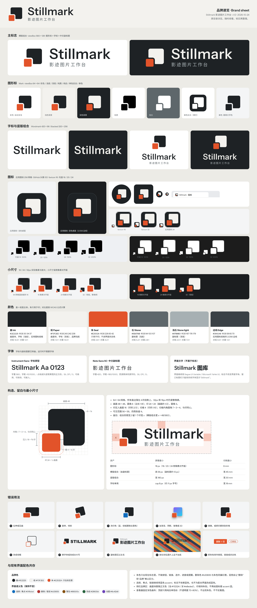

# Stillmark 品牌使用规范

> Stillmark 影迹图片工作台 · 品牌 v1.0 · 2026-10-24
> 状态：2026-10-24 用户已确认 D「压角印」，名称保留，已接入正式前端和实际桌面候选包。实际输出、图标验证与兼容策略见 [品牌集成记录](../../brand-integration-20261024.md)；以下视觉规则保持有效。



## 1. 标志的含义

**压角印（Corner Seal）**：一张方形画面（Still）的左下角，压着一枚朱色小方印（Mark）。画面给印让出一圈等宽切缝，切缝内角与印同心。

- 大方块代表**图片**。
- 角上的印代表**位置／书签**（读到这里），也代表**核验**（钤印确认）。
- 造型方正、细节少、没有渐变，适合**长期使用**。

图形里没有相机、镜头、眼睛、山和太阳，也不依赖颜色，黑白稿同样能认出来。

## 2. 文件

### 主交付（`docs/brand/stillmark/`）

| 文件 | viewBox | 用途 |
|---|---|---|
| `stillmark-mark.svg` | 0 0 64 64 | 图形标彩色版，内置 `prefers-color-scheme`，自动切换深浅 |
| `stillmark-mark-monochrome.svg` | 0 0 64 64 | 单色版，`fill="currentColor"`，默认墨色 |
| `stillmark-mark-light.svg` | 0 0 64 64 | 浅色背景用：墨＋朱 |
| `stillmark-mark-dark.svg` | 0 0 64 64 | 深色背景用：纸＋朱 |
| `stillmark-wordmark.svg` | 0 0 420 96 | 字标，自动切换深浅 |
| `stillmark-lockup.svg` | 0 0 560 128 | 横版组合（图形标＋字标＋副标题），自动切换深浅 |
| `stillmark-favicon.svg` | 0 0 16 16 | 16–32px 用：墨色底板＋图形，像素对齐 |
| `stillmark-tray.svg` | 0 0 16 16 | 托盘 16px，黑色单色，像素对齐 |
| `stillmark-app-icon.svg` | 0 0 256 256 | Windows 应用图标（48px 及以上），也是 GitHub 头像底稿 |
| `stillmark-brand-sheet.png` | — | 品牌速览 |
| `stillmark-brand-guidelines.md` | — | 本文 |

### 补充（`extra/`）

| 文件 | viewBox | 用途 |
|---|---|---|
| `stillmark-mark-black.svg` / `stillmark-mark-white.svg` | 0 0 64 64 | 纯黑、纯白 |
| `stillmark-mark-reverse.svg` | 0 0 64 64 | 单色反白：在墨色底板上镂空出图形 |
| `stillmark-mark-16.svg` / `stillmark-mark-24.svg` | 16 / 24 | 界面用的像素对齐彩色版；画面块是 `currentColor`（默认墨色），印固定为朱色 |
| `stillmark-tray-white.svg` | 0 0 16 16 | 托盘白色版 |
| `stillmark-tray-20.svg` / `stillmark-tray-20-white.svg` | 0 0 20 20 | 托盘，125% 缩放 |
| `stillmark-tray-24.svg` / `stillmark-tray-24-white.svg` | 0 0 24 24 | 托盘，150% 缩放 |
| `stillmark-app-icon-24.svg` | 0 0 24 24 | 任务栏 24px（.ico 的 24 档） |
| `stillmark-avatar.svg` | 0 0 512 512 | GitHub 头像：墨色满版底，图形占 50% |
| `stillmark-wordmark-light.svg` / `stillmark-wordmark-dark.svg` | 0 0 420 96 | 固定深浅的字标 |
| `stillmark-wordmark-ui.svg` | 0 0 190 33 | 界面用紧凑字标，cap 32，`currentColor` |
| `stillmark-lockup-light.svg` / `stillmark-lockup-dark.svg` | 0 0 560 128 | 固定深浅的横版组合，README 的 `<picture>` 用 |
| `stillmark-lockup-stacked.svg` / `stillmark-lockup-stacked-dark.svg` | 0 0 320 256 | 竖版组合，用于启动页和“关于” |

其他目录：

- `exploration/`：四个方向的图形、对比页和字标探索，只作存档。
- `previews/`：场景预览。
- `source/`：生成脚本，说明见 [source/README.md](source/README.md)。

### 技术约定

- 全部是纯路径：没有位图、滤镜、渐变、外部字体或外部 CSS，也没有编辑器元数据；坐标保留两位小数。
- 自动深浅的三个文件（mark / wordmark / lockup）内置一条 `@media (prefers-color-scheme: dark)` 样式，同时写了浅色 `fill` 属性兜底。图标转换工具忽略样式时，会得到浅色稿。
- `prefers-color-scheme` 跟随的是系统，不是应用内的主题设置。**应用界面里请用固定深浅版或 `currentColor` 版**，颜色交给界面主题决定。
- `currentColor` 文件的根节点带 `color="#1E2225"`。内联使用时，用 CSS 给 `svg` 元素本身设置 `color`，作者样式会覆盖这个属性。

## 3. 颜色

| 名称 | HEX | RGB | 用途 | 对比度 |
|---|---|---|---|---|
| 墨 Ink | `#1E2225` | 30 34 37 | 浅底上的画面块和字标；应用图标底板 | 对纸 14.3:1 |
| 纸 Paper | `#F3F2EE` | 243 242 238 | 深底上的画面块和字标；品牌浅底 | 对墨 14.3:1 |
| 朱 Seal | `#E2532A` | 226 83 42 | **只用于印** | 对纸 3.4:1，对白 3.8:1，对墨 4.2:1 |
| 石 Stone | `#5E676B` | 94 103 107 | 浅底上的副标题 | 对白 5.8:1，对纸 5.2:1 |
| 浅石 Stone light | `#A7B0B3` | 167 176 179 | 深底上的副标题 | 对墨 7.3:1 |
| 边线 Edge | `#3A4146` | 58 65 70 | 应用图标底板的 2/256 边线，让墨色底板在深色任务栏上保留轮廓 | — |

- 朱色在各种背景上都满足非文字图形 3:1 的对比度要求。它不用来写字。
- 品牌没有“主题蓝”。界面里的蓝色 accent 属于交互语义，不属于标志。
- 印刷时以 RGB 值打样对色，朱色建议找相近的专色打样确认。只能单色印刷时，用纯黑稿或反白稿。

## 4. 构造（64 × 64 网格）

| 部分 | 数值 | 关系 |
|---|---|---|
| 画面 | 48 × 48，位于 (12, 4)，圆角 6 | 圆角 = 边长的 1/8 |
| 印 | 24 × 24，位于 (4, 36)，圆角 3 | 边长 = 画面的 1/2 |
| 压入 | 16 | = 印的 2/3 |
| 切缝 | 4 | = 印的 1/6 |
| 切缝内角 | 圆角 7 | = 印圆角 3 + 切缝 4，与印同心 |
| 切口外角 | 圆角 2 | |
| 可见范围 | 56 × 56 | 四周各留 4 |

所有直边都是 4 的倍数，所以母版缩到 32px（×0.5）和 16px（×0.25）时，直边仍落在整像素上。

## 5. 留白与最小尺寸

- 组合和图形标四周，至少留 **1 个印宽 x**。横版组合里 x = 48（组合高度的 3/8）；图形标单用时，x = 图形可见宽度的 3/7。
- viewBox 已经含边距：横版组合四周留 8（图形从 8 到 120），竖版组合四周约 9。

| 资产 | 屏幕最小 | 印刷最小 |
|---|---|---|
| 图形标 | 16 px（16 / 20 / 24 用像素对齐版） | 6 mm |
| 横版组合（含副标题） | 高 56 px（此时副标题约 12 px） | 宽 45 mm |
| 竖版组合 | 宽 180 px | 宽 30 mm |
| 字标单用 | cap 8 px（约 11 px 字号） | 宽 18 mm |

横版组合低于 56px 高时，不用组合文件。改为图形标和字标分开排版（见第 8 节界面组合），副标题用界面文字另写。

## 6. 版本怎么选

| 场景 | 文件 |
|---|---|
| 浅色界面、浅色文档 | `stillmark-mark-light.svg`、`extra/stillmark-lockup-light.svg` |
| 深色界面、深色文档 | `stillmark-mark-dark.svg`、`extra/stillmark-lockup-dark.svg` |
| 网页或文档里想自动跟随系统 | `stillmark-mark.svg`、`stillmark-lockup.svg` |
| 应用侧栏 | 内联 `extra/stillmark-mark-24.svg` 和 `extra/stillmark-wordmark-ui.svg`，`color` 跟随正文色 |
| 托盘 | 浅色任务栏用黑色 `stillmark-tray*.svg`，深色任务栏用白色 `*-white.svg` |
| 查看器顶部 | `extra/stillmark-tray-white.svg`，不透明度 70–80% |
| Windows 应用图标 / .ico | 16 用 `favicon`，24 用 `app-icon-24`，32 用 `favicon` 放大 2 倍，48 及以上用 `app-icon` |
| GitHub 头像 | `extra/stillmark-avatar.svg`，导出 512 PNG |
| 照片或彩色底 | 深底用纯白，浅底用纯黑；必要时加纯色底板 |
| 单色印刷、印章、烫印 | 纯黑稿或反白稿 |

## 7. 小尺寸

64 母版直接缩到 16 或 32 时，直边也在整像素上，但圆角会发糊。托盘、任务栏、侧栏请用像素对齐版，各版参数如下：

| 网格 | 画面 | 印 | 切缝 |
|---|---|---|---|
| 托盘 / 界面 16 | (3, 1) 12 × 12 | (1, 9) 6 × 6 | 1 |
| 托盘 20 | (4, 1) 15 × 15 | (1, 11) 8 × 8 | 1 |
| 托盘 / 界面 24 | (5, 2) 18 × 18 | (2, 14) 9 × 9 | 1 |
| favicon 16（墨色底板，圆角 3） | (4, 2) 10 × 10 | (2, 9) 5 × 5 | 1 |
| 应用图标 24（墨色底板，圆角 4.5） | (6, 3) 15 × 15 | (3, 13) 8 × 8 | 1 |

- 每个尺寸都用对应的 SVG，在目标像素下直接栅格化。不要把 256 的 PNG 缩小来用。
- 深色任务栏上，24px 应用图标的墨色底板几乎看不见，靠纸色画面和朱印识别，这是预期效果。48px 及以上的 `app-icon` 带 2/256 边线。

检查图：[previews/stillmark-small-sizes.png](previews/stillmark-small-sizes.png)

## 8. 字标与组合

- 默认写法是 **Stillmark**（首字母大写）。全小写和全大写都不作为标志；正文里照常写 Stillmark。
- 字标基于 Instrument Sans：字重 560，字距 +10/1000，i 点收成与竖笔等宽的正方形，已转曲。
- **横版组合（560 × 128）**
  - 图形可见 112（64 网格 ×2），位于 (8, 8)–(120, 120)。
  - 文字从 x = 168 开始，与图形相隔 1 个印宽（48）。
  - 字标 cap 64（画面边长的 2/3），cap 顶与图形顶对齐。
  - 副标题用 Noto Sans SC，字重 420，字号 28，字距 +180/1000，石色；底边与图形底对齐，左边与 S 对齐。
- **竖版组合（320 × 256）**：图形 112 居中；图形下方 40 处是 cap 顶；cap 48（画面边长的 1/2）；副标题字号 20，位于基线下 20。
- **字标单用（420 × 96）**：cap 62，墨迹居中。
- **界面组合（侧栏）**
  - 24px 像素对齐图形，后面接一个文字块，图形与文字块相隔 10px。
  - 文字块上一行是紧凑字标，高 13px；下一行是副标题，界面字体 11px，字距 0.08em，颜色 `--text-muted`；两行相隔 4px。
- 副标题永远比字标小、颜色更浅。中文名统一写作“影迹图片工作台”。

## 9. 字体与授权

| 用途 | 字体 | 授权 | 说明 |
|---|---|---|---|
| 字标 | Instrument Sans（可变字体） | SIL OFL 1.1 | 已转曲，运行时不需要字体 |
| 中文副标题 | Noto Sans SC（可变字体，与思源黑体同源） | SIL OFL 1.1 | 已转曲 |
| 探索稿 | IBM Plex Sans、Hanken Grotesk、Source Sans 3 | SIL OFL 1.1 | 只出现在探索页 |
| 界面文字 | Segoe UI Variable、Microsoft YaHei UI | 随 Windows 提供 | 只作为界面里的实时文字，不做成标志 |

- OFL 允许用字体制作标志。转曲后的图形属于作品，不再受字体许可约束。如果分发字体文件本身，要附带 OFL 许可文本。
- 不要用微软雅黑、宋体等系统字体转曲做标志。这些字体随 Windows 授权，用于界面显示；做商业标志需要向字体版权方另行取得授权。
- 需要重新排字时的替代方案：英文用 Inter 或 Source Sans 3（OFL），中文用思源黑体 Source Han Sans SC（OFL）。换字体后要重新调整字距和 cap 对齐，不能直接套用本文的数值。
- 窗口标题栏只能用系统字体显示“Stillmark”文字，这是正常情况。

## 10. 错误用法

1. 拉伸、压扁、旋转、倾斜。
2. 改印色（例如蓝、绿或跟随主题色），或把整个图形改成朱色。
3. 加渐变、阴影、描边、玻璃或 3D 效果。
4. 镜像，或把印挪到别的角，或改变两块方形的比例。
5. 改成线框。
6. 换字体、改大小写、改字距，或重新排字标。
7. 副标题比字标大或更醒目。
8. 放在杂乱图片上，且不加底板。
9. 把朱色用作按钮、链接、选中、进度或状态色。
10. 在图形里加相机、眼睛、对勾、文件夹等元素，或把图形塞进圆形、盾牌等外框。

## 11. 与现有界面共存

- **朱色只用在标志里**，不做按钮、链接、选中、进度或提醒。界面的删除色 `#b33835` 和朱色同属红橙色系，混用会让“删除”和“品牌”难以区分。
- **选择、焦点、链接继续用蓝色 accent**（`#0f6cbd` / `#115ea3`）。标志不依赖蓝色，也不为配合界面改成蓝色。
- **侧栏**：画面块跟随正文色（浅色 `#1f2324`，深色 `#e8eded`，与墨、纸在视觉上等效），印保持朱色。现在给图标套 `--accent-text` 的写法要去掉。
- **查看器**：画布固定深色，顶部只放纯白单色标，不透明度 70–80%，不出现朱色。
- **启动页**：用纸色或墨色底，进度条用石色。不用朱色，也不用界面蓝。
- **深色主题**：画面块用纸色，不要把整个标志反相；朱色保持不变。
- 界面图标继续用 Lucide。标志不放进 Lucide 的图标位，也不要把 Lucide 图标改成朱色。

场景预览：

- [浅色工作台](previews/stillmark-workbench-light.png)
- [深色工作台](previews/stillmark-workbench-dark.png)
- [查看器](previews/stillmark-viewer.png)
- [启动页](previews/stillmark-splash.png)
- [Windows](previews/stillmark-windows.png)
- [GitHub](previews/stillmark-github.png)

## 12. 工程接入（确认后执行）

以下是交给工程侧的任务清单。本阶段没有改动这些文件。

### 12.1 导出位图

导出方式与 `source/render.cjs` 相同：用 Edge 在目标像素下直接栅格化，背景透明。

- 托盘
  - `electron/tray.png`：`stillmark-tray.svg`，16px
  - `tray@1.25x.png`：`extra/stillmark-tray-20.svg`，20px
  - `tray@1.5x.png`：`extra/stillmark-tray-24.svg`，24px
  - `tray@2x.png`：`stillmark-tray.svg`，32px
  - 白色再导出一套同名 `tray-white*.png`，分别用对应的 `*-white.svg`。
- `.ico`

  | 尺寸 | 来源 |
  |---|---|
  | 16 | `stillmark-favicon.svg` |
  | 24 | `extra/stillmark-app-icon-24.svg` |
  | 32 | `stillmark-favicon.svg` 在 32px 下栅格化 |
  | 48 / 64 / 128 / 256 | `stillmark-app-icon.svg` |

- GitHub 头像：`extra/stillmark-avatar.svg`，导出 512px PNG。

### 12.2 Electron（`electron/main.js`）

- 窗口标题 `title: '图库'` 改为 `'Stillmark'`，`BrowserWindow` 加 `icon` 指向 .ico。
- 托盘图片按 `nativeTheme.shouldUseDarkColorsForSystemIntegratedUI` 选黑或白（Electron 44 提供，在 Windows 上区分系统主题和应用主题）。收到 `nativeTheme.on('updated')` 后调用 `tray.setImage()`。
- 托盘提示改为 `'Stillmark'`；菜单“打开图库”改为“打开 Stillmark”。
- 用 `app.setAppUserModelId()` 设置一个带发布者前缀的唯一 ID。原因见 [README 第 10 节](README.md#10-商标github-仓库名与同名产品)。

### 12.3 打包（`scripts/build.ps1`）

- 现在 `electron.exe` 改名为 `GalleryTool.exe` 后没有图标。改名后用 rcedit 写入 .ico，以及版本信息（ProductName、FileDescription 设为 Stillmark）。
- exe 文件名是否改成 `Stillmark.exe` 需要另外决定，要一并检查快捷方式和自启动项。

### 12.4 前端

- `ui/index.html`：标题改为 `<title>Stillmark</title>`，并加 `<link rel="icon" type="image/svg+xml" href="…/stillmark-favicon.svg">`。
- 侧栏 `ui/src/components/Sidebar.tsx`（`.brand`）：
  - 把 Lucide `Images` 图标和“图库”文字，换成内联的 `extra/stillmark-mark-24.svg`、`extra/stillmark-wordmark-ui.svg`（高 13px），再加副标题“影迹图片工作台”（11px，`--text-muted`）。
  - `ui/src/styles/shell.css` 里的 `.brand > .icon { color: var(--accent-text) }` 改为 `.brand svg { color: var(--text) }`。
- 查看器顶部（如果需要品牌锚点）：`extra/stillmark-tray-white.svg`，16px，不透明度 0.78。
- 启动页（如果需要）：竖版组合，纸色或墨色底，石色进度条。

### 12.5 README 顶部

```html
<p align="center">
  <picture>
    <source media="(prefers-color-scheme: dark)" srcset="docs/brand/stillmark/extra/stillmark-lockup-dark.svg">
    
  </picture>
</p>
```

### 12.6 不变的部分

数据目录、`GALLERY_DATA`、配置文件名都不随品牌改名，也不迁移任何用户数据。

### 12.7 验收

- 在 100%、125%、150%、200% 缩放下，托盘图标都清晰，并随任务栏深浅切换黑白。
- 任务栏、Alt+Tab、标题栏、开始菜单和 exe 文件图标都显示 Stillmark，而不是 Electron 默认图标。
- 侧栏标志跟随应用内主题切换，而不是跟随系统。
- 界面里除了标志，没有其他地方出现朱色。
- README 在 GitHub 浅色和深色主题下，各显示对应的组合。

## 13. 再生成

修改比例或重新导出时，参见 [source/README.md](source/README.md)。
